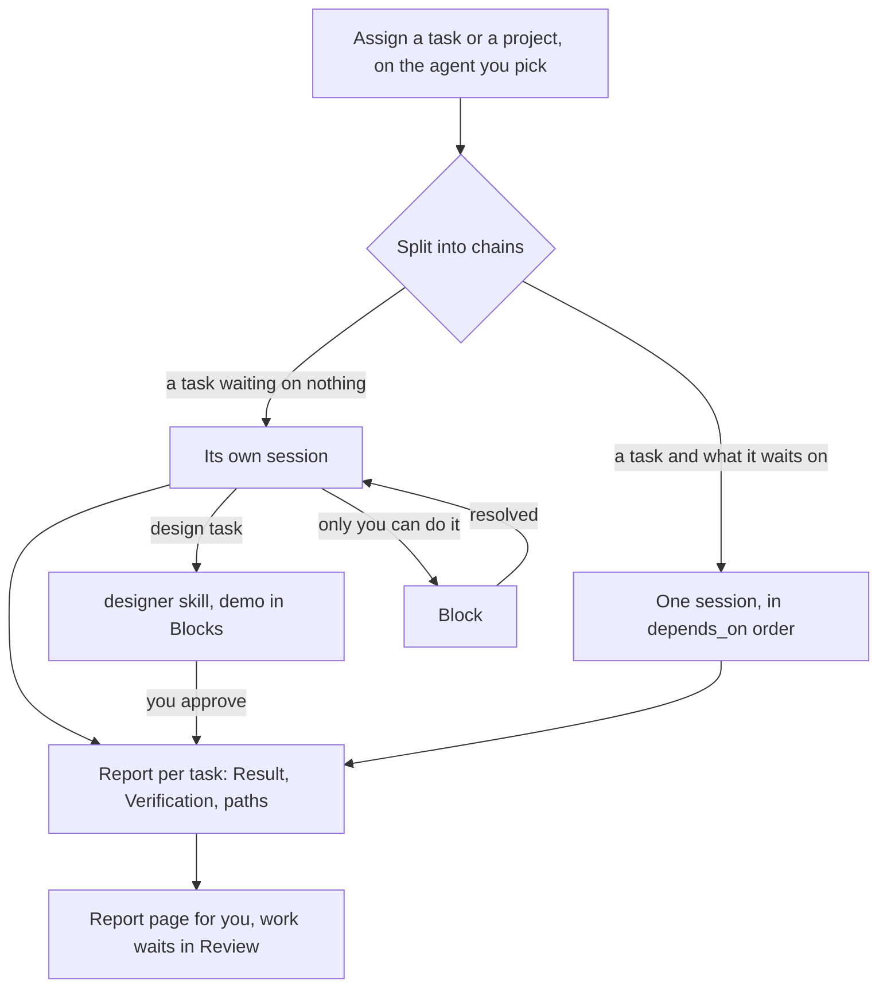

# Yongkang

A dark console for running an agent team: multiple `claude`, `codex`, `grok`, or `agy`
CLI sessions, the notebook they work from, and the changes they produce. More at
[yongkang.ai](https://yongkang.ai).


## Install

1. Download `Yongkang.dmg` from the
   [latest release](https://github.com/jstinhw/yongkang/releases/latest).
2. Open it and drag **Yongkang** to **Applications**, then launch it from there. The app is
   signed and notarized, so macOS opens it without a warning.
3. Later versions download in the background; **Yongkang → Restart to Update** installs one.

You need:

- macOS 14 or later
- At least one of `claude`, `codex`, `grok` or `agy` on PATH (they launch via `zsh -ilc`, so
  `.zshrc` applies)

## The window

One window holds every project at once. Beside the **rail**, which picks the section, the
**sidebar** lists each open project — under Agents with its running sessions underneath, under
Board with its tasks that are not idle — amber when one needs you, green when its work waits for
your review. Pick a project for its board or its sessions side by side; under Agents each project
also has its memory, and **Usage**, pinned below them all, is every project's spend. Pick a
session for its terminal, its transcript and its task's Done when. The **work area** holds
whatever is picked, and on most screens an **inspector** carries what you would otherwise have
to go and find. The rail's sections are Board and Agents: the work, and whoever is on it. You can
drag the sidebar's edge to resize it, or past its narrowest to hide it, and back out to show it;
the screen's name and the project are the window's own title and subtitle.

Every action is also a menu item, because a shortcut hung on a button only answers while that
button is drawn. File, View and Agent hold `⌘N` (New Agent), `⇧⌘N`, `⌘O`, `⌘T` (New Terminal), `⌘1`–`⌘2` and `⌘\`.

## Build from source

You need Xcode 16 or later to build the app. On Xcode 26, also run
`xcodebuild -downloadComponent MetalToolchain` once: Xcode compiles SwiftTerm's shaders.
[CONTRIBUTING.md](CONTRIBUTING.md) has the rest: the pre-push hook, branches and pull requests.

```sh
make run                             # builds the app with Xcode and opens it
make check                           # format lint, build, and the tests
make shots DIR=/tmp/ui               # renders every screen to PNG, offscreen
make help                            # every target
```

The shots come from a fixed sample notebook, so two runs are comparable — except `review.png`,
`handover.png` and `usage.png`, which are drawn from whatever repository the command is run in
and from this machine's own agent transcripts.

## How it works

The `.notebook/` folder is the only state — the app keeps none of its own. It never
writes what the agents write, and no agent commits without your approval in Review.



## Docs

- [Projects](docs/guide/projects.md) — folders, the sidebar of every project, New Agent
- [Notebooks](docs/guide/notebook.md) — the `.notebook/` entries and how they're edited
- [Board](docs/guide/board.md) — the dependency-ordered task board
- [Design before code](docs/guide/design-gate.md) — the designer gate before the build
- [Product review](docs/guide/product.md) — describing features and reviewing the product
- [Shipping tasks](docs/guide/engineering-lead.md) — assigning work to the agent you pick
- [The team](docs/guide/team.md) — the roster in `.notebook/team/`
- [Review](docs/guide/review.md) — approving and committing agent work
- [Blocks](docs/guide/blocks.md) — gates only you can clear
- [Notebook format](docs/notebook-format.md) — the spec written to `.notebook/NOTEBOOK.md`
- [Development](docs/development.md) — contributing to the app itself
- [Releasing](docs/release.md) — versions, releases, updates, and what goes online
- [AGENTS.md](AGENTS.md) — instructions for agents working in this repo
- [Refactor plan](docs/refactor-plan.md) — the decisions behind this repo's shape

## License

[MIT](LICENSE). To report a vulnerability, see [SECURITY.md](SECURITY.md).
