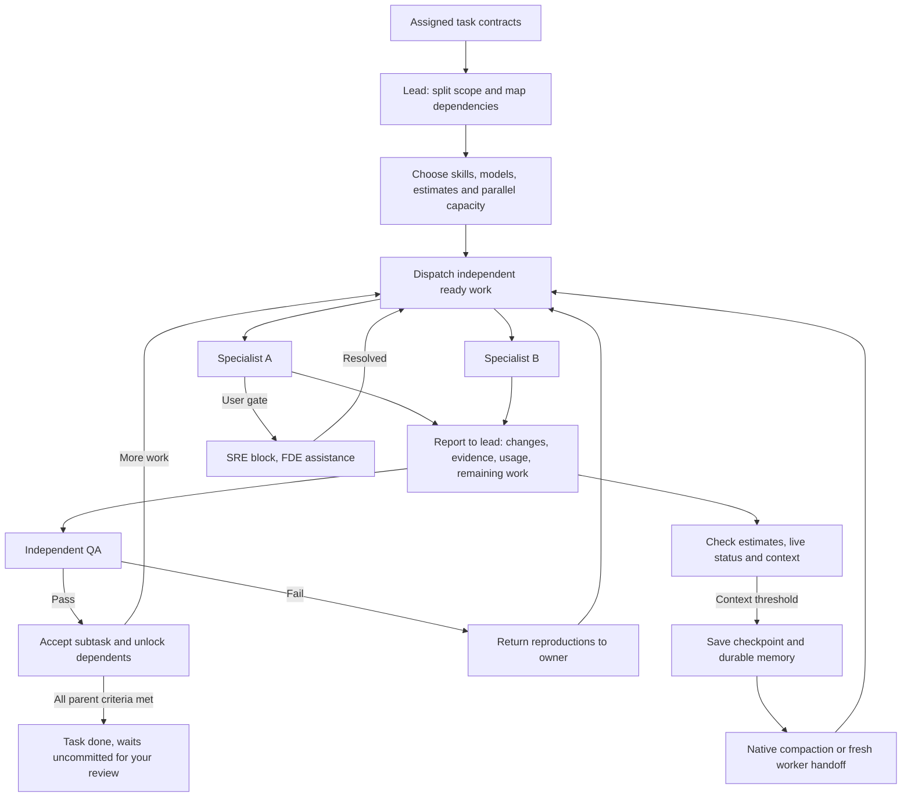

# Yongkang.app

A dark console for running an agent team: multiple `claude`, `codex`, `grok`, or `agy` CLI sessions in real PTYs (SwiftTerm), the notebook they work from, and the changes they produce. Nothing starts until you pick a folder — that keeps macOS from prompting for iCloud Drive / Music / Documents, which is what happened when it defaulted to `$HOME`.

Every screen is the same four columns: a **rail** picking the section, a **list** of that section's objects, the **work area** holding whichever one is selected, and an **inspector** carrying what you would otherwise have to go and find. The rail's sections are Overview, Board, Agents, Review, Blocks and Terminals.

Inside a project, use the Agent switch in the top bar to choose Claude Code, Codex, Grok, or Agy. The choice is remembered and applies to new notebook setup, Product, Engineering Lead, unblock, and plain sessions; sessions already running keep their original agent.

```sh
./make-app.sh && open .build/Yongkang.app
```

Requires whichever of `claude`, `codex`, `grok`, or `agy` you select on your PATH (they launch via `zsh -ilc`, so `.zshrc` applies).

## Projects

A project is a folder. The app opens on the all-projects screen; click a card to enter
one, `‹ All Projects` (⌘[) to leave. Agents keep running while you are away — terminals
are hidden, never torn down.

Two tiles sit at the end of the grid, one per door. `Describe a new project…` (⌘N) opens
a prompt: say what to build and tag anything it should read with `@`. Where the folder
goes is worked out from the prompt — `~/code/todo` in it is enough — and otherwise it is
named after the prompt and lands beside the projects you already have (`~/Projects` on a
first run). The line under the box says where before you press Return. The folder is
created and the prompt goes straight to the session that writes its notebook.
`Open a folder you have` (⌘O) is the other door, for a folder that already exists; an
empty one asks what it is for on the way in.

Open projects come back on the next launch. Only the folders are remembered, not the
sessions — those PTYs died with the app — and a folder that has since moved is dropped
from the list rather than shown broken.

Inside a project, `Overview` is what it is doing right now: the agents running, what is
waiting on you, what changed on disk, and what the agents last wrote to the notebook.
Everything on it is read from the notebook, the transcripts and git — the app keeps no
state of its own to drift.

## Notebooks

Every project has a notebook. It stays empty until you add an entry — nothing is
written to the folder before that, so opening a project never touches your repo.

An empty project opens a compose box instead of a blank pane: describe what the
project is for and press Return. That text starts a session with the selected agent, carrying the
notebook format. It fills the gaps with a few multiple-choice questions — never open
ones — then writes `.notebook/` without showing you a plan first — reading a real notebook on the board beats approving an
imaginary one. Calls it had to make on your behalf land as memory entries, so they are
visible and correctable. The app writes nothing; the agent does. Entries look like:

```
<project>/.notebook/
  NOTEBOOK.md                 the format, written for whichever agent reads it first
  roadmap/<id>.md             goals and bets
  projects/<id>/project.md    one project
  projects/<id>/memory/*.md   that project's memory, one fact per file
  tasks/<id>.md               shippable work, linked to a project by frontmatter
  runs/<timestamp>-<id>.md    one agent-team session and its handoff
```

Every entry is Markdown with flat YAML frontmatter (`id`, `kind`, `status`, `depends_on`,
`roadmap`, `project`, `subject`, `designer`, `external`). Nothing else stores state, so the agents in the console edit
the notebook by editing files — no bridge, no API. The console re-reads the tree every
2s, so entries an agent writes show up on their own.

Roadmaps and memories open as human-readable native pages, like projects and tasks;
run records stay on disk for agents but are hidden from notebook navigation. Edit opens
the underlying Markdown. A save is refused if an agent changed
the file after the editor loaded it, so concurrent work cannot be silently overwritten.
The first body paragraph is the short human brief. Durable facts remain project memory;
managed sessions record their result and handoff under runs; engineering leads also keep a coordination plan and subtask attempt records there.

## Board

`Board` is one column per project, its tasks reading downwards in build order. A task sits
under everything it waits on, so position is the dependency and no card has to spell it
out — the only `waits on` line left is for an id nothing resolves to, which shows in
amber, and is how you catch a typo in `depends_on`. Columns are bounded by how many
projects you have rather than by the longest chain, so the board never scrolls sideways.

Detail goes where it is worth something. A whole card is spent on the live edge of each
chain — what is being designed, what is waiting on your approval, what an agent is on,
what is blocked, and whatever could start next — and everything finished or still queued
behind something is one line. Clicking any of them picks it for a batch and dims what is
unrelated; the arrow on a card opens its own page.

The inspector carries the batch: what you picked, what came along as a blocker, and in
which order it will be built. The roadmap and projects are in the list column beside the
board, which no longer repeats the tasks the board is already showing.

Completed projects and tasks are hidden from the list, board and project task lists by
default. `Completed` in the top bar reveals them everywhere at once. A project counts as
finished when its own status says so, or when every task under it is done.

## Design before code

A task that changes something you can look at is designed, and approved by you, before an
engineer touches it. Nothing is inferred: Product decides, and writes `designer: <name>`
into the task's frontmatter. Empty means ordinary work that goes straight to the lead.

When the lead picks up such a task it sets `status: designing` and runs the `designer`
skill on it first. The designer settles the layout in Claude Code's `/design` canvas,
builds it as a running demo on a throwaway `demo/<task-id>` branch, and writes one
`kind: demo` file to `.notebook/blocks/`. The rest of the batch carries on meanwhile — one
demo does not idle the others.

The board shows that task as `demo ready` with `See demo`, which opens the two pages side
by side: the screen as it stands, and the screen this task would give you. `Before` is
empty and says so when the task adds a surface that does not exist yet. Every pass the
designer made is a chip on the `Revisions` strip, so you can follow how the change got
there rather than being handed one finished thing; a pass they kept serving opens again.

`Build it` clears the demo and tells the lead which revision won — only then does the task
go to an engineer. `Request changes` opens the transcript of whoever built it, because the
point is that you say what is wrong in your own words. Saying no throws the branch away;
nothing was merged and no task status moved.

## Product review

`Describe New Feature…` in the top bar's `New` menu starts a Product conversation. Describe
what the user should be able to do; the agent does not research or invent features in this
mode. It asks only the decisions that change the scope, then writes one project and its
dependency-ordered tasks directly to the notebook.

`Product Review` on the board starts a session that reads the whole notebook — roadmap,
projects, tasks, memory, the last run records — inspects the product, researches relevant
current alternatives when useful, and works out what should come next. It presents at
most three ranked directions in the Product transcript and asks for feedback there. One
`.notebook/blocks/` notification links back to that same conversation; draft alternatives
do not become separate proposals and looking at the board does not move it.

Once the decisions are settled, Product replaces that notification with the complete
proposal: roadmap impact, project, dependency-ordered tasks, agent resources and the
rationale for each. `Request changes` returns to the Product transcript. `Create project`
is the explicit approval that writes the roadmap changes (when proposed), project and
tasks to the notebook. Nothing is assigned by that; picking stays yours — but the whole
project goes in one gesture when you want it to, `Pick all` on its page.

## Shipping tasks

Click task cards and `Assign to Engineering Lead` to give a batch to the coordinator.
`Pick all` on a project's page takes every task of its that is not done or already out
with a lead, and `Assign all tasks to Engineering Lead` on the project's row in the list
does the same without opening it.
It reads the task contracts and code boundaries, chooses the smallest useful split,
and selects a roster specialist, available model and reasoning level for every subtask.
Independent work starts in parallel; shared files and unfinished prerequisites wait.
The lead adjusts concurrency to the runtime's free slots and the work that is ready.

Every worker reports to the lead at start, milestones, blockers and completion. A
returned build enters `review`; independent QA accepts it or sends reproductions back
to its owner. Only integrated work that meets the parent task's full acceptance criteria
makes that task `done`. Nobody in the batch commits, pushes, branches or opens a PR —
the work waits uncommitted for you in `Review`, and a lead session is refused those
commands outright (`--disallowedTools` for Claude Code, `--deny` for Grok).



The lead compares total token estimates (including planning, repeated context and QA)
with the elapsed time of the scheduled dependency path. It uses fewer agents when a
split adds overhead without a useful speed gain. Model choices come from the running
provider's available options, so a model that cannot be selected is never promised.
This uses the native parent/child reporting mechanism described in the
[Codex subagent documentation](https://learn.chatgpt.com/docs/agent-configuration/subagents).

Context budgets are workflow policy: a fresh handoff aims for at most 8K tokens or 10%
of the effective model window, whichever is smaller; checkpoint/compact at 60% and
hand off before further bulk reads at 75%. Runtime warnings take precedence. Unknown
capacity stays unknown. The lead keeps volatile checkpoints in run records and promotes
only durable facts to project memory; saving a summary is followed by actual native
compaction or a fresh worker when supported.

The roles are skills in `.claude/skills/`: `product`, `engineering-lead`, `designer`,
`frontend-dev`, `backend-dev`, `qa-dev`, `sre-dev`, `fde-dev`. One roster member runs both
`designer` and `frontend-dev` — the same agent settles what a screen looks like and then
builds it, in that order. `.agents/skills/` links to those same files
for Codex, so the two agents cannot drift. The app bundles the exact skill text into every
managed session. Install the same role folders in `~/.claude/skills/` and
`~/.agents/skills/` only for specialist subagents, which start outside the app's launcher
(symlinks to one shared folder are fine).

The engineers are that lead session's own subagents, not sibling terminals. Separate
PTYs have no way to report back to a lead, so the review loop only closes inside one
agent.

Agent rows open the live **Session**; **Transcript** is hidden for now. A task's
**Check** action and subagent rows open the CLI's live child view. The app opens
`/tasks` in Claude Code or `/subagents` in Codex and selects the row matching that child's
ID or task description. If the CLI truncates the identity or changes its picker layout,
a notice asks you to select the child in the picker. **Parent session** returns to the
lead. Queued messages for the lead wait while a child view is open. The task link
is the subagent's own name: the lead names each one `<task-id>-<subtask>-<attempt>-<role>`, Claude keeps that
as the subagent's description and Codex slugs it into the spawned thread's name, and the
app matches them back to the task either way. `Agents` in the rail shows that hierarchy
directly: Engineering Lead is the parent and every `<task-id>-<subtask>-<attempt>-<role>` agent is its child.
The lead's **Agents** pane opens the coordination dashboard. The plan and parallel capacity
come first, followed by parent tasks and their subtasks. Worker cards show the skill,
model and selection reason, dependency waits, reported state, last check-in, token and
time estimates, observed usage, and the returned result. Finished workers remain
available. The inspector carries batch progress and context/checkpoint details; the
roster is secondary to the work. `Check` opens the worker's live CLI view and a block opens
its existing resolution flow. Its `Agents / Session` switch opens the live terminal.

The lead writes `.notebook/runs/<session-id>-coordination.md` and one
`<session-id>-work-<work-id>.md` per attempt, using the schema in the
[engineering-lead skill](.claude/skills/engineering-lead/SKILL.md). The app reads them on
its existing poll; it does not schedule agents itself. These run records stay hidden
from ordinary notebook navigation. Legacy sessions still show their transcript-linked
workers, with missing estimates/context shown as unknown. Provider token measurements
are separate from lead estimates; elapsed wall time does not claim to be CPU time.

Claude subagents are read from
`~/.claude/projects/<slug>/<session-id>/subagents/`; Codex, which picks its own thread id
rather than taking one, is found by the session id the app's opening prompt quotes and
then by the rollouts in `~/.codex/sessions/` pointing back at that thread.
Grok transcripts and usage are read from its UUID-addressed session under
`~/.grok/sessions/<encoded-project>/`; Agy currently runs in its live terminal only.

## The team

The specialists the lead routes to are files, not code: one Markdown file per agent in
`.notebook/team/`, each with `name`, the `skills` that are its system prompt, and the
`owns` line the lead routes by. The five shipped agents are written there the first time
a lead starts in a project with a notebook; after that the folder is the truth, so
editing a file — or deleting one — changes who gets dispatched. `Agents` in the rail
lists the roster under the running sessions, and opening one shows the skill text the
agent is actually handed plus its agents running right now.

`New → Agent…` adds one, two ways:

**Manual** is the form: a name, the skills to give it, and what it owns. The skill list is
every skill this project can already load — `.claude/skills/` and `.agents/skills/` in the
project, the same two folders in `$HOME`, and the ones packaged with the app — listed by
folder, which is the name an agent asks for. `From a git repo` shallow-clones a repo,
copies every folder in it holding a `SKILL.md` into the project's `.claude/skills/`, and
links each one into `.agents/skills/` so Claude Code and Codex read the same file; what it
installed is ticked for you. Pointing it at the same repo again updates those skills.

**Incubate** is a description instead of a form: say what the agent should do and a
session goes and builds it — reads the skills you already have, fetches a published one or
writes a new one when nothing fits, then writes the roster file. The app writes nothing
here, the same rule the notebook follows, and the new agent appears on the roster when
that session lands — it runs the packaged `incubate-agent` skill, which is what knows
where skills live and what a roster file has to say.

## Review

No agent commits. A task QA passed waits in `Review` with its work uncommitted, and you
decide: approve it, which commits it, or send it back with what to change. The rail's
Review icon lights green while anything is waiting, and so does each waiting task's row.

A project with a notebook that is not a git repository is made one (`git init`) the first
time Review looks at it — there is no diff and nowhere to commit without one. Nothing is
staged or committed by that.

The list column is tasks, not files: **Waiting for you** (done, work still uncommitted),
**With the agents** (still being built or checked), and **All changes** for the whole
working tree, including edits no task claims.

A task opens on what most reviews need, not on code:

- **The task** — its brief and `Done when`, read from the task file.
- **Reviewer** — QA's verdict, as pass or fail, with the `## Result` it wrote: the
  commands it ran, what they said, and what it could not exercise.
- **What the agents did** — each specialist in its own words (`## Result`, or its report),
  with model, time and the files it owned. A later attempt shows the comments it was
  answering under **You asked**.
- **Changes by area** — the task's files grouped as Database, API & services, Frontend,
  Tests, Config, each with the lines it added and removed. The area is worked out by the
  app from the path, SQL in the diff, and the owning worker's skill, so a data layer that
  writes SQL is flagged as Database even with no migration folder.

A file opens its diff on its own page. Click any line to leave a comment on it; comments and a note for
anything that is not about one line collect under **Feedback for the agents** until you
send them. The inspector carries the verdict, the areas, what the commit will hold, and a
warning when a file is also changed by another task still waiting.

The bar at the bottom is the decision, on the task page and on its diffs alike:

- **Approve and commit** stages and commits only this task's files and its run records —
  whatever else is in the tree or the index is left as it was. Nothing is pushed.
- **Request changes** types `Changes requested on <task-id>`, your note and every line
  comment (`path:line`, with the code it is about) into the lead holding the task. With no
  lead running, a new one starts with the task and the comments. The lead sends each
  comment to the owner of that file as a new attempt, reruns QA, and the task comes back
  to **Waiting for you**.

None of it is written for this screen; it is the run records in `.notebook/runs/`, where
`paths` on each work record is what attributes a file to a task. They are read from disk,
not from the sessions open now, so work stays waiting for review after a relaunch or after
its lead is closed. A task turning `done`
opens its review by itself, unless a terminal is up — that pane has the keyboard.

## Blocks

Anything only you can settle lives in `.notebook/blocks/` and shows in the `Blocks`
section of the rail — a product proposal waiting for your opinion, a design waiting for
your approval, or an agent that
needs a token, a consent screen, an approval and is sitting there until it has one. The
row says what is being asked and what it holds up; the button sends it to whoever can act
on it, which for a proposal is product and for a gate is an engineer.

A gate is written by the agent that hit it, and it keeps waiting. SRE writes the procedure into
the block under `## Steps`, addressed to an engineer rather than to you, and asks you
nothing itself.

`Do It Now` starts a forward-deployed engineer whose only job is that gate. It opens no
browser tab: first it says what is being set up and what it unblocks, and waits for you
to say go. Then it takes SRE's steps and sits with you through them one at a time — the
page for this step opened with the instruction that needs it, one reply, the
configuration and verification done for you between them, and never a secret echoed back
or written down. You never see the list.

Clearing it is one edit to the block file — `status: done` and a `resolution:` line —
made by that session, or by `Mark Resolved` if you did it yourself. The app sees it on
the next poll and tells the waiting agent to carry on. The file is the whole channel;
there is nothing else to keep in sync, and a block survives a restart.

Frontmatter keys are Notion properties, folders are databases, and `external.notion`
holds the page id, so an exporter to Notion (or any third-party notebook) is a pure
function over these files. `NOTEBOOK.md` spells out the mapping and the rules that keep
it true.

```sh
swift run Yongkang --selftest        # checks the on-disk format has not drifted
swift run Yongkang --shots /tmp/ui   # renders every screen to PNG from a fixed sample
```

`--shots` draws each screen through an offscreen window at 1440×900. A layout that clips
or collapses is invisible in a compiler pass and obvious in a picture, and the screens are
too wide to check by launching the app on every change.
