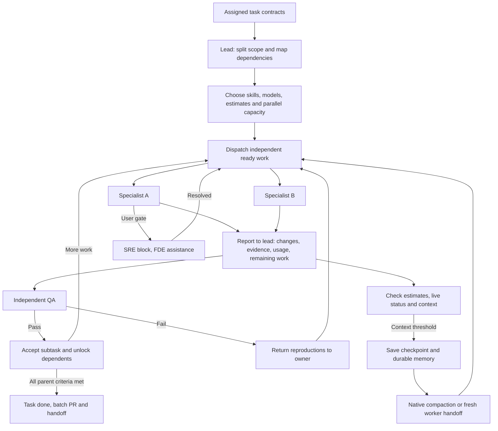

# Yongkang.app

A dark console for running an agent team: multiple `claude`, `codex`, `grok`, or `agy` CLI sessions in real PTYs (SwiftTerm), the notebook they work from, and the changes they produce. Nothing starts until you pick a folder — that keeps macOS from prompting for iCloud Drive / Music / Documents, which is what happened when it defaulted to `$HOME`.

Every screen is the same four columns: a **rail** picking the section, a **list** of that section's objects, the **work area** holding whichever one is selected, and an **inspector** carrying what you would otherwise have to go and find. The rail's sections are Overview, Board, Agents, Review, Blocks and Terminals.

Inside a project, use the Agent switch in the top bar to choose Claude Code, Codex, Grok, or Agy. The choice is remembered and applies to new notebook setup, Product, Engineering Lead, unblock, and plain sessions; sessions already running keep their original agent.

```sh
./make-app.sh && open .build/Yongkang.app
```

Requires whichever of `claude`, `codex`, `grok`, or `agy` you select on your PATH (they launch via `zsh -ilc`, so `.zshrc` applies).

## Projects

A project is a folder. The app opens on the all-projects screen; click a card to enter
one, `‹ All Projects` (⌘[) to leave. Agents keep running while you are away — terminals
are hidden, never torn down.

Open projects come back on the next launch. Only the folders are remembered, not the
sessions — those PTYs died with the app — and a folder that has since moved is dropped
from the list rather than shown broken.

Inside a project, `Overview` is what it is doing right now: the agents running, what is
waiting on you, what changed on disk, and what the agents last wrote to the notebook.
Everything on it is read from the notebook, the transcripts and git — the app keeps no
state of its own to drift.

## Notebooks

Every project has a notebook. It stays empty until you add an entry — nothing is
written to the folder before that, so opening a project never touches your repo.

An empty project opens a compose box instead of a blank pane: describe what the
project is for and press Return. That text starts a session with the selected agent, carrying the
notebook format. It fills the gaps with a few multiple-choice questions — never open
ones — then writes `.notebook/` without showing you a plan first — reading a real notebook on the board beats approving an
imaginary one. Calls it had to make on your behalf land as memory entries, so they are
visible and correctable. The app writes nothing; the agent does. Entries look like:

```
<project>/.notebook/
  NOTEBOOK.md                 the format, written for whichever agent reads it first
  roadmap/<id>.md             goals and bets
  projects/<id>/project.md    one project
  projects/<id>/memory/*.md   that project's memory, one fact per file
  tasks/<id>.md               shippable work, linked to a project by frontmatter
  runs/<timestamp>-<id>.md    one agent-team session and its handoff
```

Every entry is Markdown with flat YAML frontmatter (`id`, `kind`, `status`, `depends_on`,
`roadmap`, `project`, `subject`, `external`). Nothing else stores state, so the agents in the console edit
the notebook by editing files — no bridge, no API. The console re-reads the tree every
2s, so entries an agent writes show up on their own.

Roadmaps and memories open as human-readable native pages, like projects and tasks;
run records stay on disk for agents but are hidden from notebook navigation. Edit opens
the underlying Markdown. A save is refused if an agent changed
the file after the editor loaded it, so concurrent work cannot be silently overwritten.
The first body paragraph is the short human brief. Durable facts remain project memory;
managed sessions record their result and handoff under runs; engineering leads also keep a coordination plan and subtask attempt records there.

## Board

`Board` lays every task out in lanes, ordered so nothing appears before what it depends
on — the lanes read as the build order, `READY` first. Cards show status, project and
what they wait on; an id nothing resolves to shows in amber, which is how you catch a
typo in `depends_on`. Clicking a card picks it for a batch and dims everything unrelated
to it; the arrow on a card opens its own page. The roadmap, projects and tasks that used
to share this screen are in the list column beside it.

Completed projects and tasks are hidden from the list, board and project task lists by
default. `Completed` in the top bar reveals them everywhere at once. A project counts as
finished when its own status says so, or when every task under it is done.

## Product review

`Describe New Feature…` in the top bar's `New` menu starts a Product conversation. Describe
what the user should be able to do; the agent does not research or invent features in this
mode. It asks only the decisions that change the scope, then writes one project and its
dependency-ordered tasks directly to the notebook.

`Product Review` on the board starts a session that reads the whole notebook — roadmap,
projects, tasks, memory, the last run records — inspects the product, researches relevant
current alternatives when useful, and works out what should come next. It presents at
most three ranked directions in the Product transcript and asks for feedback there. One
`.notebook/blocks/` notification links back to that same conversation; draft alternatives
do not become separate proposals and looking at the board does not move it.

Once the decisions are settled, Product replaces that notification with the complete
proposal: roadmap impact, project, dependency-ordered tasks, agent resources and the
rationale for each. `Request changes` returns to the Product transcript. `Create project`
is the explicit approval that writes the roadmap changes (when proposed), project and
tasks to the notebook. Nothing is assigned; picking tasks stays yours.

## Shipping tasks

Click task cards and `Assign to Engineering Lead` to give a batch to the coordinator.
It reads the task contracts and code boundaries, chooses the smallest useful split,
and selects a roster specialist, available model and reasoning level for every subtask.
Independent work starts in parallel; shared files and unfinished prerequisites wait.
The lead adjusts concurrency to the runtime's free slots and the work that is ready.

Every worker reports to the lead at start, milestones, blockers and completion. A
returned build enters `review`; independent QA accepts it or sends reproductions back
to its owner. Only integrated work that meets the parent task's full acceptance criteria
makes that task `done`. The lead opens the batch PR after QA; merging stays yours.



The lead compares total token estimates (including planning, repeated context and QA)
with the elapsed time of the scheduled dependency path. It uses fewer agents when a
split adds overhead without a useful speed gain. Model choices come from the running
provider's available options, so a model that cannot be selected is never promised.
This uses the native parent/child reporting mechanism described in the
[Codex subagent documentation](https://learn.chatgpt.com/docs/agent-configuration/subagents).

Context budgets are workflow policy: a fresh handoff aims for at most 8K tokens or 10%
of the effective model window, whichever is smaller; checkpoint/compact at 60% and
hand off before further bulk reads at 75%. Runtime warnings take precedence. Unknown
capacity stays unknown. The lead keeps volatile checkpoints in run records and promotes
only durable facts to project memory; saving a summary is followed by actual native
compaction or a fresh worker when supported.

The roles are skills in `.claude/skills/`: `product`, `engineering-lead`, `frontend-dev`,
`backend-dev`, `qa-dev`, `sre-dev`, `fde-dev`. `.agents/skills/` links to those same files
for Codex, so the two agents cannot drift. The app bundles the exact skill text into every
managed session. Install the same role folders in `~/.claude/skills/` and
`~/.agents/skills/` only for specialist subagents, which start outside the app's launcher
(symlinks to one shared folder are fine).

The engineers are that lead session's own subagents, not sibling terminals. Separate
PTYs have no way to report back to a lead, so the review loop only closes inside one
agent.

A task's own page lists the subagents working on it under `Working on it`, running or
done, and `Check` opens that one's transcript — read live off disk, which is as close as
either CLI gets to attaching to a single subagent (`/tasks` in Claude Code and `/agent` in
Codex both open a picker, and neither can be told which row to take; the `Terminal` button
on a subagent's page sends whichever of the two its session speaks). The link
is the subagent's own name: the lead names each one `<task-id>-<subtask>-<attempt>-<role>`, Claude keeps that
as the subagent's description and Codex slugs it into the spawned thread's name, and the
app matches them back to the task either way. `Agents` in the rail shows that hierarchy
directly: Engineering Lead is the parent and every `<task-id>-<subtask>-<attempt>-<role>` agent is its child.
Selecting the lead opens the coordination dashboard. The plan and parallel capacity
come first, followed by parent tasks and their subtasks. Worker cards show the skill,
model and selection reason, dependency waits, reported state, last check-in, token and
time estimates, observed usage, and the returned result. Finished workers remain
available. The inspector carries batch progress and context/checkpoint details; the
roster is secondary to the work. `Check` opens the worker's transcript and a block opens
its existing resolution flow. Its `Agents / Session` switch opens the live terminal.

The lead writes `.notebook/runs/<session-id>-coordination.md` and one
`<session-id>-work-<work-id>.md` per attempt, using the schema in the
[engineering-lead skill](.claude/skills/engineering-lead/SKILL.md). The app reads them on
its existing poll; it does not schedule agents itself. These run records stay hidden
from ordinary notebook navigation. Legacy sessions still show their transcript-linked
workers, with missing estimates/context shown as unknown. Provider token measurements
are separate from lead estimates; elapsed wall time does not claim to be CPU time.

Claude subagents are read from
`~/.claude/projects/<slug>/<session-id>/subagents/`; Codex, which picks its own thread id
rather than taking one, is found by the session id the app's opening prompt quotes and
then by the rollouts in `~/.codex/sessions/` pointing back at that thread.
Grok transcripts and usage are read from its UUID-addressed session under
`~/.grok/sessions/<encoded-project>/`; Agy currently runs in its live terminal only.

## The team

The specialists the lead routes to are files, not code: one Markdown file per agent in
`.notebook/team/`, each with `name`, the `skills` that are its system prompt, and the
`owns` line the lead routes by. The five shipped agents are written there the first time
a lead starts in a project with a notebook; after that the folder is the truth, so
editing a file — or deleting one — changes who gets dispatched. `Agents` in the rail
lists the roster under the running sessions, and opening one shows the skill text the
agent is actually handed plus its agents running right now.

`New → Agent…` adds one, two ways:

**Manual** is the form: a name, the skills to give it, and what it owns. The skill list is
every skill this project can already load — `.claude/skills/` and `.agents/skills/` in the
project, the same two folders in `$HOME`, and the ones packaged with the app — listed by
folder, which is the name an agent asks for. `From a git repo` shallow-clones a repo,
copies every folder in it holding a `SKILL.md` into the project's `.claude/skills/`, and
links each one into `.agents/skills/` so Claude Code and Codex read the same file; what it
installed is ticked for you. Pointing it at the same repo again updates those skills.

**Incubate** is a description instead of a form: say what the agent should do and a
session goes and builds it — reads the skills you already have, fetches a published one or
writes a new one when nothing fits, then writes the roster file. The app writes nothing
here, the same rule the notebook follows, and the new agent appears on the roster when
that session lands — it runs the packaged `incubate-agent` skill, which is what knows
where skills live and what a roster file has to say.

## Review

`Review` reads what the agents changed, as a diff, without leaving the window: the files
against `HEAD` in the list column, a unified diff in the middle, and the branch, commit
and per-file stats in the inspector. It shells out to `git` in the project folder, so it
can never disagree with the terminal sitting next to it.

It opens on the handover rather than on a file, and the handover is per task rather than
one pile of files: each task the batch was given, the specialists that built it as a row
of who ran in what order, what each one reported back, QA's verdict underneath the build
it accepted, and that task's own diff as one bar per file it changed. Bars share one scale
across the screen, so a big task looks bigger. Files no task claimed — your own edits, or
a lead that recorded none — are listed at the end under **Not claimed by a task**, because
they are going into the commit too. The lead's own sentence about how it split the work
and every checkpointed decision are quoted under **Design decisions**.

None of it is written for this screen; it is the run records in `.notebook/runs/`, where
`paths` on each work record is what attributes a file to a task, so the summary can never
claim work the notebook does not show. A bar, or a file in the list, opens that diff;
`Summary and commit` goes back.

A task turning `done` opens this screen by itself, unless a terminal is up — that pane has
the keyboard, and taking it away would drop your next keystrokes into an agent you can no
longer see.

Along the bottom is the commit line, prefilled with the tasks that passed QA and yours to
edit. It stages everything and commits, and that is the only write this app makes to your
repo. Pushing and merging stay yours — the lead stops at the PR.

## Blocks

Anything only you can settle lives in `.notebook/blocks/` and shows in the `Blocks`
section of the rail — a product proposal waiting for your opinion, or an agent that
needs a token, a consent screen, an approval and is sitting there until it has one. The
row says what is being asked and what it holds up; the button sends it to whoever can act
on it, which for a proposal is product and for a gate is an engineer.

A gate is written by the agent that hit it, and it keeps waiting. SRE writes the procedure into
the block under `## Steps`, addressed to an engineer rather than to you, and asks you
nothing itself.

`Do It Now` starts a forward-deployed engineer whose only job is that gate. It opens no
browser tab: first it says what is being set up and what it unblocks, and waits for you
to say go. Then it takes SRE's steps and sits with you through them one at a time — the
page for this step opened with the instruction that needs it, one reply, the
configuration and verification done for you between them, and never a secret echoed back
or written down. You never see the list.

Clearing it is one edit to the block file — `status: done` and a `resolution:` line —
made by that session, or by `Mark Resolved` if you did it yourself. The app sees it on
the next poll and tells the waiting agent to carry on. The file is the whole channel;
there is nothing else to keep in sync, and a block survives a restart.

Frontmatter keys are Notion properties, folders are databases, and `external.notion`
holds the page id, so an exporter to Notion (or any third-party notebook) is a pure
function over these files. `NOTEBOOK.md` spells out the mapping and the rules that keep
it true.

```sh
swift run Yongkang --selftest        # checks the on-disk format has not drifted
swift run Yongkang --shots /tmp/ui   # renders every screen to PNG from a fixed sample
```

`--shots` draws each screen through an offscreen window at 1440×900. A layout that clips
or collapses is invisible in a compiler pass and obvious in a picture, and the screens are
too wide to check by launching the app on every change.
