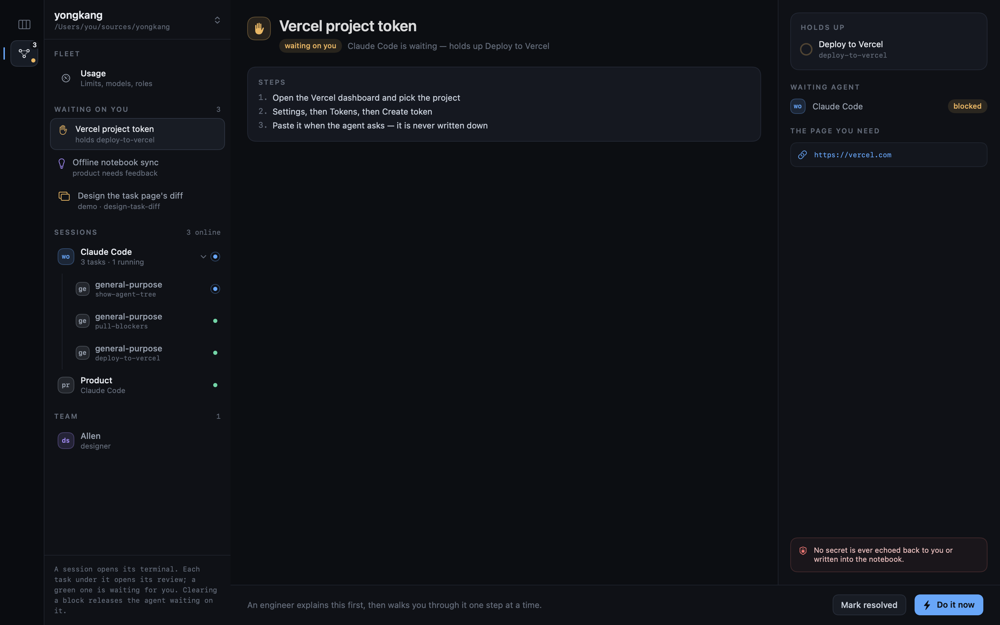

# Blocks



Anything only you can settle lives in `.notebook/blocks/` and shows under **Waiting on
you** at the top of `Agents`, above the sessions — a product proposal waiting for your
opinion, a design waiting for your approval, or an agent that
needs a token, a consent screen, an approval and is sitting there until it has one. The
row says what is being asked and what it holds up; the button sends it to whoever can act
on it, which for a proposal is product and for a gate is a session of its own.

A gate is written by the agent that hit it, and it keeps waiting. It writes the procedure
into the block under `## Steps` and carries on with whatever does not need it.

`Do it now` starts a session whose only job is that gate, on the toolbar's agent. It does
every step that does not need you first, then says what it unblocks and takes the rest
with you one step at a time — the page for that step opened for you with the one
instruction that needs it, verified before the next, and never a secret echoed back or
written down.

Clearing it is one edit to the block file — `status: done` and a `resolution:` line —
made by that session, or by `Mark resolved` if you did it yourself. The app sees it on the
next read and tells the waiting agent to carry on. The file is the whole channel;
there is nothing else to keep in sync, and a block survives a restart.

Frontmatter keys are Notion properties, folders are databases, and `external.notion`
holds the page id, so an exporter to Notion (or any third-party notebook) is a pure
function over these files. `NOTEBOOK.md` spells out the mapping and the rules that keep
it true.

```sh
swift test                           # checks the on-disk format has not drifted
swift run shots /tmp/ui              # renders every screen to PNG from a fixed sample
```

`shots` draws each screen through an offscreen window, 1440×900 unless the screen is one of
the narrow variants that check the window's own minimum. A layout that clips or collapses is
invisible in a compiler pass and obvious in a picture, and the screens are too wide to check by
launching the app on every change. The one thing it cannot draw is the window's title bar, so
the toolbar and the menus are only ever checked in a running app.
