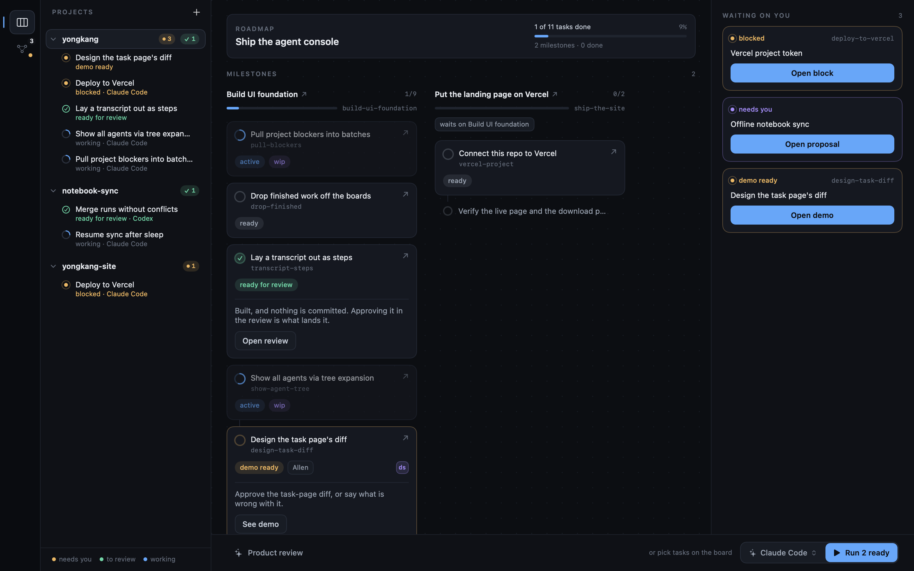

# Board

Pick a project in the sidebar and `Board` shows its notebook: the roadmap across the top — the
goal, how many of its tasks are done and how many milestones it has — then one column per
milestone, each an outline read downwards. A milestone is what the notebook files as
`kind: project`; the window calls it a milestone so it cannot be mistaken for the project folder
that holds the whole notebook. Clicking the roadmap opens its page. Under each project the sidebar
lists its tasks that are not idle — waiting for your approval, ready for review, or being worked
on — so what is moving in a project you are not looking at is one glance away.

A task is drawn under the one it waits on, joined to it by a line, and **no line above a card
means nothing is in its way** — that card can start now. Columns are bounded by how many milestones there are
rather than by the longest chain, so the board never scrolls sideways.

A step in marks a *fork*, never a link. One task waiting on a card continues the run at the
same indent; only a card with two or more waiting on it steps its children in, and each
branch runs on flat from there. So indentation counts the forks on the path rather than the
tasks, and a milestone five tasks deep costs one step, not five. Three steps is the ceiling.

What position cannot show, the card says. A second blocker, a task in another milestone, one
hidden by `Completed`, or an id that resolves to nothing all appear as a `waits on` line —
`also waits on` when a line above already says what it waits on. An unresolvable id shows in
amber, and is how you catch a typo in `depends_on`. A milestone that waits on another says so
once, as a chip under its column's heading.

Detail goes where it is worth something. A whole card is spent on the live edge of each
chain — what is being designed, what is waiting on your approval, what an agent is on,
what is blocked, and whatever could start next — and everything finished or still queued
behind something is one line. Clicking any of them picks it for a batch and dims what is
unrelated; the arrow on a card opens its own page.

Where a column has a choice about what to draw first, the shortest goes first: the work
that could start now sits above the chain that cannot, and under a fork the branch that runs
on longest is the one drawn directly beneath it.

The inspector carries what is waiting on you, and what the console will do with the batch —
whether a designer has to build a screen first. The batch itself is the board: the cards you
picked and the ones they pulled in stay lit, and the bar below counts them.

The bar is where agents are started. With nothing picked it offers `Product review` on the left
and, on the right, the agent beside `Run N ready`, which gives every task that could start now a
session of its own. Pick cards and the left side becomes a count of the picks and the blockers
they pulled in, whose `×` clears them, and the button becomes `Assign N`.

Completed milestones and tasks are hidden from the board and milestone task lists by default.
The filter button in the toolbar, or `View ▸ Show Completed`, reveals them everywhere at once. A
milestone counts as finished when its own status says so, or when every task under it is done.
