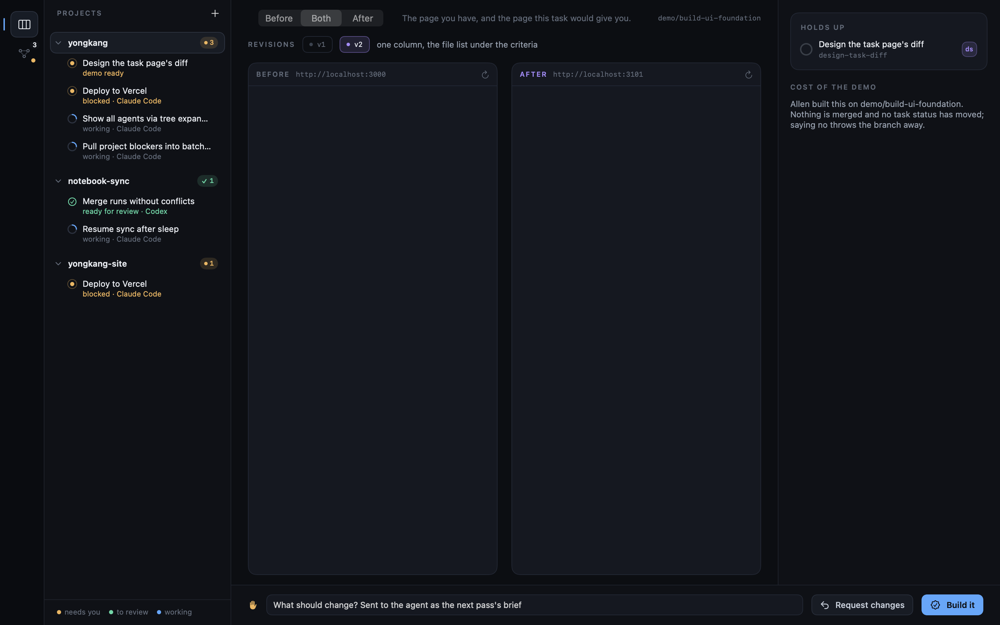

# Design before code

A task that changes something you can look at is designed, and approved by you, before
anyone builds it. Nothing is inferred: Product decides, and writes `designer: <name>`
into the task's frontmatter. Empty means ordinary work that goes straight to the agent.

When a session picks up such a task it sets `status: designing` and runs the `designer`
skill on it first. The designer builds it as a running demo straight in the project's own
stack, uncommitted on the branch the session is on, and writes one `kind: demo` file to
`.notebook/blocks/`. A page is designed by building it, not drawn on a canvas first and then
built again; only a product that does not run in a browser gets a canvas instead. The rest of the session's tasks carry on
meanwhile — one demo does not idle the others.

The board shows that task as `demo ready` with `See demo`, which opens the two pages side
by side: the screen as it stands, and the screen this task would give you. `Before` is
empty and says so when the task adds a surface that does not exist yet. Every pass the
designer made is a chip on the `Revisions` strip, so you can follow how the change got
there rather than being handed one finished thing; a pass they kept serving opens again.

The demo is a live page, never a picture of one: opening it, or a new revision arriving,
loads the latest version, and each pane's reload button fetches it again. A demo served on
this Mac stops when Yongkang quits, since the designer's session was serving it. The demo
file's `serve:` line is the command that serves it. The first time a demo's page is down when
you open it, Yongkang shows you that exact command and asks before running it, since the line
comes from a file in the project and a cloned repo brings its own. Once you say `Run`, that
command runs by itself in a `Serve <task>` terminal whenever its page is down: when Yongkang
opens again, or when you open the demo. A changed command asks again.

`Build it` clears the demo and tells the waiting session which revision won — only then
does the work on that screen start. To say no, write what should change in the box beside
the buttons, in your own words, and `Request changes` sends it to whoever has the demo as
the brief for the next pass. The demo stays open, and what comes back is another revision
on the same strip, not the task started again. If that session has since exited, the
design task picks up where the demo file says it got to. None of the demo is committed
until you approve it in Review.
