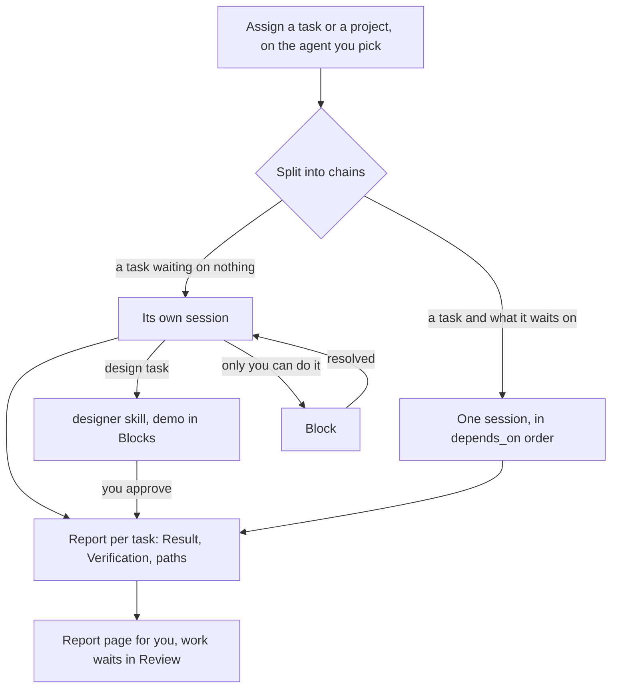

# Shipping tasks

Every Assign button has an agent picker beside it — Claude Code, Codex, Grok or Agy —
starting on the toolbar's agent. Picking one there is for that assignment only; the
toolbar keeps its default.

What you assign is split into chains, and each chain gets a session of its own, named
after its work:

- **A task:** `Assign` on its page starts one session on that task, together with any
  unfinished tasks it waits on — those cannot run beside it, so they share its session and
  go first.
- **A project:** `Pick all` on the project's page, or `Assign all tasks to` on its row in
  the list, takes every open task of its. Tasks that wait on nothing start side by side,
  one session each; a chain of dependent tasks is one session that works down it.
- **A batch:** tasks picked on the board are split the same way.

One session opens in the window. Several go to Overview, whose **Running now** lists each
of them, so they are all in sight even with the list hidden. A session
already running is never handed more, because its agent may not be the one you picked, and
a task a session already holds cannot be assigned again until that session exits.

There are no specialist roles. Each session reads its tasks, what they depend on and the
project's memory, and does the work; the prompt only carries what the app reads back:

- set a task `active` when it starts and `done` once every item of its `Done when` is
  checked;
- a task with `designer:` set goes through the `designer` skill, and nothing waiting on it
  starts until you approve the demo — see [Design before code](design-gate.md);
- anything only you can do becomes a block — see [Blocks](blocks.md);
- nobody commits, pushes, branches or opens a PR. A session holding tasks is refused
  those commands outright (`--disallowedTools` for Claude Code, `--deny` for Grok), and
  the work waits uncommitted for you in [Review](review.md).

For every task it writes `.notebook/runs/<session-id>-work-<work-id>.md` — the task id,
then `-2`, `-3` for a later attempt — with the files it changed in `paths`, a one-line
`report`, and `## Result` and `## Verification` in the body. That record is what Review
reads and what approving a task commits beside its code. When it stops, done or waiting
on you, it shows the same report as a page: an artifact where the agent can publish one,
otherwise an HTML file in the temp folder that it opens for you.

`Agents` in the rail lists every session in the project, live or exited, with what each one
has spawned under it — so several sessions working at once are one list, and clicking a row
opens that session. A task's own page names who is on it under **Working on it**: the
session it was assigned to, and any subagent working it. Clicking the session opens its
transcript; clicking a subagent opens the CLI's live child view. Overview's **Running now**
is the same set for the whole project, one card per agent with the task it is on.

A session opens on its live terminal while it works. Once a task of its is done and its
files wait for your approval, its row turns green — "1 ready for review" — and opens on its
**result** instead: the same page as the task's in [Review](review.md), anything waiting on
you first, with a strip of the chain's tasks along the top when the session holds several.
One toolbar button switches between the two: **Result** from the terminal, **Session** back.

A subagent is linked to its task by its own name, which the prompt asks to be the task id;
Claude keeps that as the subagent's description and Codex slugs it into the spawned thread's
name, and the app matches it back either way. Clicking a subagent, in the Agents list or
under **Working on it** on a task's page, opens the CLI's live child view: the app opens
`/tasks` in Claude Code or `/subagents` in Codex and selects the matching row. **Parent
session** returns to the session.

Claude subagents are read from
`~/.claude/projects/<slug>/<session-id>/subagents/`; Codex, which picks its own thread id
rather than taking one, is found by the session id the app's opening prompt quotes and
then by the rollouts in `~/.codex/sessions/` pointing back at that thread.
Grok transcripts and usage are read from its UUID-addressed session under
`~/.grok/sessions/<encoded-project>/`; Agy currently runs in its live terminal only.
