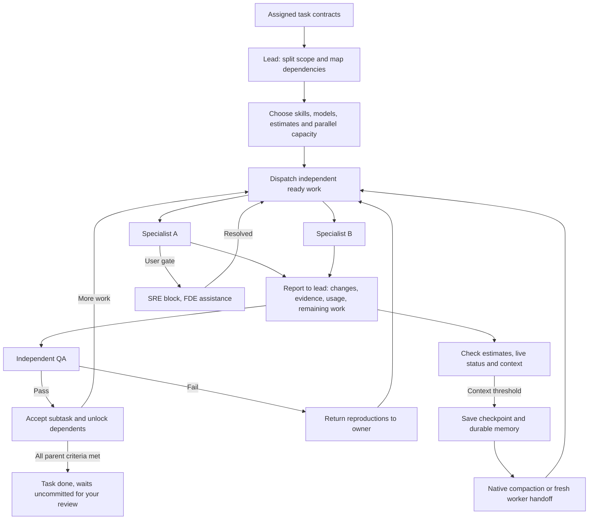

# Shipping tasks

Click task cards and `Assign to Engineering Lead` to give a batch to the coordinator.
`Pick all` on a project's page takes every task of its that is not done or already out
with a lead, and `Assign all tasks to Engineering Lead` on the project's row in the list
does the same without opening it.
It reads the task contracts and code boundaries, chooses the smallest useful split,
and selects a roster specialist, available model and reasoning level for every subtask.
Independent work starts in parallel; shared files and unfinished prerequisites wait.
The lead adjusts concurrency to the runtime's free slots and the work that is ready.

Every worker reports to the lead at start, milestones, blockers and completion. A
returned build enters `review`; independent QA accepts it or sends reproductions back
to its owner. Only integrated work that meets the parent task's full acceptance criteria
makes that task `done`. Nobody in the batch commits, pushes, branches or opens a PR —
the work waits uncommitted for you in `Review`, and a lead session is refused those
commands outright (`--disallowedTools` for Claude Code, `--deny` for Grok).

The lead compares total token estimates (including planning, repeated context and QA)
with the elapsed time of the scheduled dependency path. It uses fewer agents when a
split adds overhead without a useful speed gain. Model choices come from the running
provider's available options, so a model that cannot be selected is never promised.
This uses the native parent/child reporting mechanism described in the
[Codex subagent documentation](https://learn.chatgpt.com/docs/agent-configuration/subagents).

Context budgets are workflow policy: a fresh handoff aims for at most 8K tokens or 10%
of the effective model window, whichever is smaller; checkpoint/compact at 60% and
hand off before further bulk reads at 75%. Runtime warnings take precedence. Unknown
capacity stays unknown. The lead keeps volatile checkpoints in run records and promotes
only durable facts to project memory; saving a summary is followed by actual native
compaction or a fresh worker when supported.

The roles are skills in `Skills/`: `product`, `engineering-lead`, `designer`,
`frontend-dev`, `backend-dev`, `qa-dev`, `sre-dev`, `fde-dev`. One roster member runs both
`designer` and `frontend-dev` — the same agent settles what a screen looks like and then
builds it, in that order. `.claude/skills/` and `.agents/skills/` link to that folder,
so Claude Code and Codex working on this repo read the same files. The app bundles the exact skill text into every
managed session. Install the same role folders in `~/.claude/skills/` and
`~/.agents/skills/` only for specialist subagents, which start outside the app's launcher
(symlinks to one shared folder are fine).

The engineers are that lead session's own subagents, not sibling terminals. Separate
PTYs have no way to report back to a lead, so the review loop only closes inside one
agent.

Agent rows open the live **Session**; **Transcript** is hidden for now. A task's
**Check** action and subagent rows open the CLI's live child view. The app opens
`/tasks` in Claude Code or `/subagents` in Codex and selects the row matching that child's
ID or task description. If the CLI truncates the identity or changes its picker layout,
a notice asks you to select the child in the picker. **Parent session** returns to the
lead. Queued messages for the lead wait while a child view is open. The task link
is the subagent's own name: the lead names each one `<task-id>-<subtask>-<attempt>-<role>`, Claude keeps that
as the subagent's description and Codex slugs it into the spawned thread's name, and the
app matches them back to the task either way. `Agents` in the rail shows that hierarchy
directly: Engineering Lead is the parent and every `<task-id>-<subtask>-<attempt>-<role>` agent is its child.
The lead's **Agents** pane opens the coordination dashboard. The plan and parallel capacity
come first, followed by parent tasks and their subtasks. Worker cards show the skill,
model and selection reason, dependency waits, reported state, last check-in, token and
time estimates, observed usage, and the returned result. Finished workers remain
available. The inspector carries batch progress and context/checkpoint details; the
roster is secondary to the work. `Check` opens the worker's live CLI view and a block opens
its existing resolution flow. Its `Agents / Session` switch opens the live terminal.

The lead writes `.notebook/runs/<session-id>-coordination.md` and one
`<session-id>-work-<work-id>.md` per attempt, using the schema in the
[engineering-lead skill](../../Skills/engineering-lead/SKILL.md). The app reads them on
its existing poll; it does not schedule agents itself. These run records stay hidden
from ordinary notebook navigation. Legacy sessions still show their transcript-linked
workers, with missing estimates/context shown as unknown. Provider token measurements
are separate from lead estimates; elapsed wall time does not claim to be CPU time.

Claude subagents are read from
`~/.claude/projects/<slug>/<session-id>/subagents/`; Codex, which picks its own thread id
rather than taking one, is found by the session id the app's opening prompt quotes and
then by the rollouts in `~/.codex/sessions/` pointing back at that thread.
Grok transcripts and usage are read from its UUID-addressed session under
`~/.grok/sessions/<encoded-project>/`; Agy currently runs in its live terminal only.
