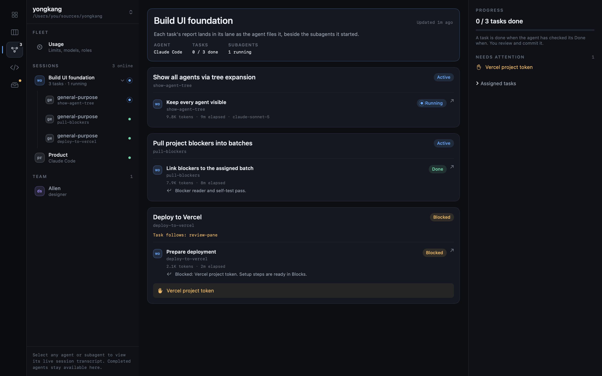
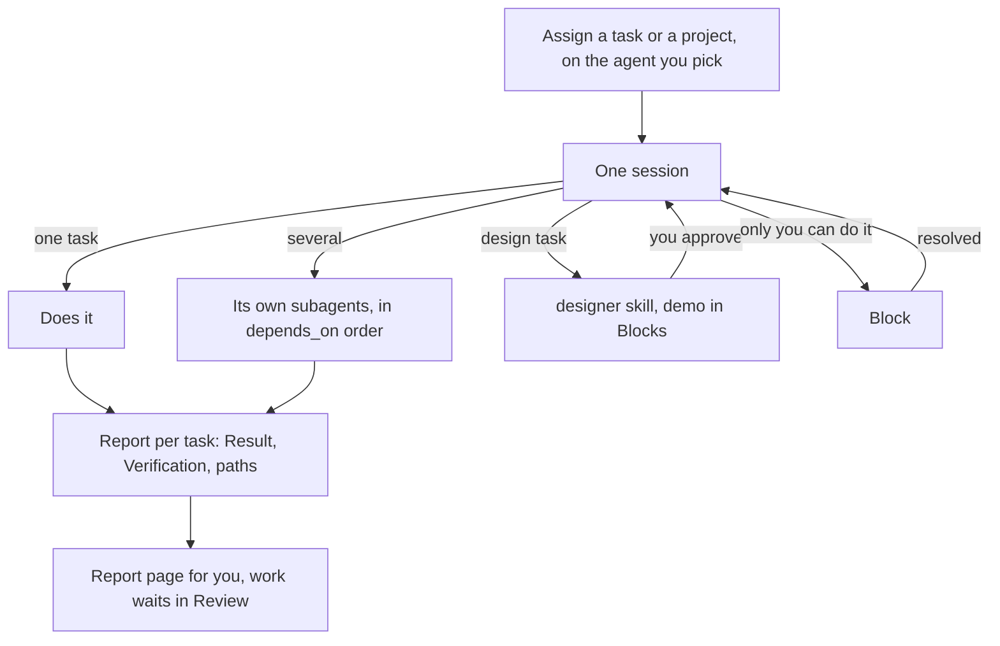

# Shipping tasks

Every Assign button has an agent picker beside it — Claude Code, Codex, Grok or Agy —
starting on the toolbar's agent. Picking one there is for that assignment only; the
toolbar keeps its default.

- **A task:** `Assign` on its page starts one session on that task, with any unfinished
  blockers it waits on.
- **A project:** `Pick all` on the project's page, or `Assign all tasks to` on its row in
  the list, starts one session on all of its open tasks. That session decides how to split
  them, and runs independent ones at once with its own subagents if its CLI has them.
- **A batch:** tasks picked on the board go to one session the same way.

Each assignment is a new session named after its work. A session already running is never
handed more, because its agent may not be the one you picked; a task a session already
holds cannot be assigned again until that session exits.

There are no specialist roles. The agent reads the task, what it depends on and the
project's memory, and does the work; the prompt only carries what the app reads back:

- set a task `active` when it starts and `done` once every item of its `Done when` is
  checked;
- a task with `designer:` set goes through the `designer` skill, and nothing waiting on it
  starts until you approve the demo — see [Design before code](design-gate.md);
- anything only you can do becomes a block — see [Blocks](blocks.md);
- nobody commits, pushes, branches or opens a PR. A session holding tasks is refused
  those commands outright (`--disallowedTools` for Claude Code, `--deny` for Grok), and
  the work waits uncommitted for you in [Review](review.md).

For every task it writes `.notebook/runs/<session-id>-work-<work-id>.md` — the task id,
then `-2`, `-3` for a later attempt — with the files it changed in `paths`, a one-line
`report`, and `## Result` and `## Verification` in the body. That record is what Review
reads and what approving a task commits beside its code. When it stops, done or waiting
on you, it shows the same report as a page: an artifact where the agent can publish one,
otherwise an HTML file in the temp folder that it opens for you.

The session's **Agents** pane is its work board: one lane per task with its report and
the subagents it started, and progress and anything waiting on you beside it. A subagent is
linked to its task by its own name, which the prompt asks to be the task id; Claude keeps
that as the subagent's description and Codex slugs it into the spawned thread's name, and
the app matches it back either way. Clicking a subagent, here or under **Working on it** on
a task's page, opens the CLI's live child view: the app opens `/tasks` in Claude Code or
`/subagents` in Codex and selects the matching row. **Parent session** returns to the
session. Its `Agents / Session` switch opens the live terminal.

Claude subagents are read from
`~/.claude/projects/<slug>/<session-id>/subagents/`; Codex, which picks its own thread id
rather than taking one, is found by the session id the app's opening prompt quotes and
then by the rollouts in `~/.codex/sessions/` pointing back at that thread.
Grok transcripts and usage are read from its UUID-addressed session under
`~/.grok/sessions/<encoded-project>/`; Agy currently runs in its live terminal only.
