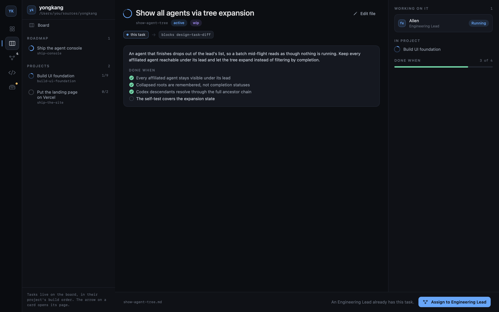

# Notebooks



Every project has a notebook. It stays empty until you add an entry — nothing is
written to the folder before that, so opening a project never touches your repo.

An empty project opens a compose box instead of a blank pane: describe what the
project is for and press Return. That text starts a session with the selected agent, carrying the
notebook format. It fills the gaps with a few multiple-choice questions — never open
ones — then drafts the plan under Blocks before writing any of it: what you will have once
it is built, the projects, and every task with what it waits on and what can start
together. Change it in that session until it is right; `Create project` writes the roadmap,
projects and tasks. Calls it had to make on your behalf land as memory entries, so they are
visible and correctable. Once it has said what it created, the session closes and the window
moves to the board it filled; Product takes the plans after that. The app writes nothing; the
agent does. Entries look like:

```
<project>/.notebook/
  NOTEBOOK.md                 the format, written for whichever agent reads it first
  roadmap/<id>.md             goals and bets
  projects/<id>/project.md    one project
  projects/<id>/memory/*.md   that project's memory, one fact per file
  tasks/<id>.md               shippable work, linked to a project by frontmatter
  runs/<timestamp>-<id>.md    one agent-team session and its handoff
```

Every entry is Markdown with flat YAML frontmatter (`id`, `kind`, `status`, `depends_on`,
`roadmap`, `project`, `subject`, `designer`, `external`). Nothing else stores state, so the agents in the console edit
the notebook by editing files — no bridge, no API. The console watches the folder rather than
re-reading it on a clock, so entries an agent writes show up on their own, about a third of a
second after the last one lands.

Roadmaps and memories open as human-readable native pages, like projects and tasks;
run records stay on disk for agents but are hidden from notebook navigation. Edit opens
the underlying Markdown. A save is refused if an agent changed
the file after the editor loaded it, so concurrent work cannot be silently overwritten.
The first body paragraph is the short human brief. Durable facts remain project memory;
managed sessions record their result and handoff under runs; a session assigned tasks also files one report per attempt at a task there.
