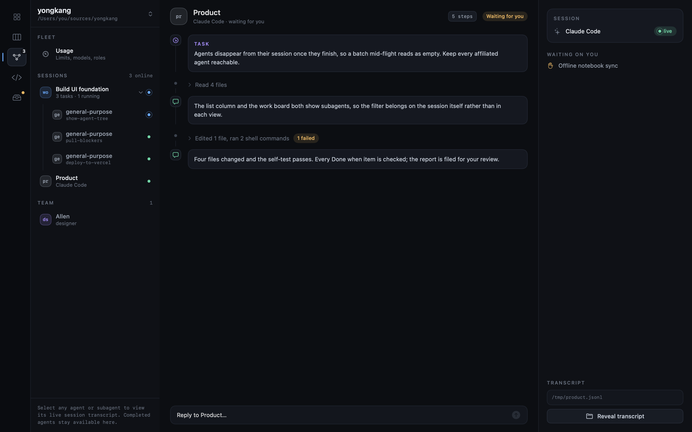

# Product review

`Describe New Feature…` in the toolbar's `New` menu starts a Product conversation. Describe
what the user should be able to do; the agent does not research or invent features in this
mode. It asks only the decisions that change the scope, then writes one project and its
dependency-ordered tasks directly to the notebook.

`Product review` on the board — or `Agent ▸ Product Review`, which works from any screen —
starts a session that reads the whole notebook — roadmap,
projects, tasks, memory, the last run records — inspects the product, researches relevant
current alternatives when useful, and works out what should come next. It presents at
most three ranked directions in the Product transcript and asks for feedback there. One
`.notebook/blocks/` notification links back to that same conversation; draft alternatives
do not become separate proposals and looking at the board does not move it.

Once the decisions are settled, Product replaces that notification with the complete
proposal: roadmap impact, project, dependency-ordered tasks, agent resources and the
rationale for each. `Request changes` returns to the Product transcript. `Create project`
is the explicit approval that writes the roadmap changes (when proposed), project and
tasks to the notebook. Nothing is assigned by that; picking stays yours — but the whole
project goes in one gesture when you want it to, `Pick all` on its page.
