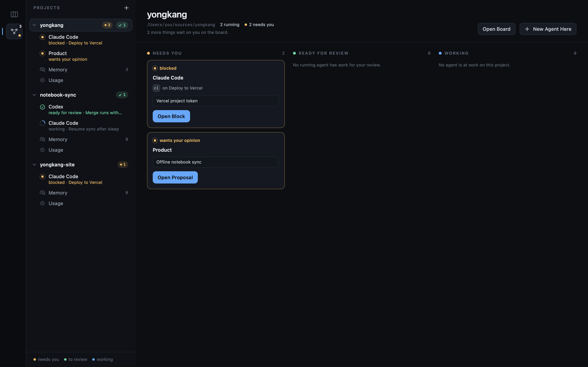

# Projects

Nothing starts until you pick a folder — that keeps macOS from prompting for iCloud
Drive / Music / Documents, which is what happened when it defaulted to `$HOME`.

A project is a folder, and every open one is in the sidebar at once, with its running sessions
listed under it. Nothing is picked when the app opens: the sidebar is the way in. A
project's row carries an amber count for what is waiting on you there — a block, a demo, a
proposal, a question in an agent's terminal — and a green one for finished work waiting for your
review, so a project you are not looking at still says when it needs you. The counts are the
whole project's: a demo or a review left by a session that has exited still needs you, and is
opened from the board. Under Agents a project lists its running sessions, each with its own
name, then what it is doing and on which task: `Codex`, `asks a question · Wire auth`. Under
Board it lists its tasks that are not idle — waiting for your approval, ready for your review, or
out with a running session — each with what is happening on it and who is on it: `Wire auth`,
`working · Codex`. A task that could start, or is waiting its turn, is only on the board.

Click a project to see it in the section you are in: its board under Board, its running
sessions side by side under Agents. Click a session to open its terminal. Under Agents each
project also has a **Memory** row: what its agents decided and learned, filed by milestone,
which every agent reads before it starts. **Usage**, pinned under every project, is what all of
their agents have spent, split by project, model and agent. Right-click a project to reveal its
folder or close it; the folder stays on disk. Agents keep running whichever project is on screen:
terminals are hidden, never torn down.

The `+` beside **Projects** is the two doors, and the `File` menu opens either from anywhere.
`New Project…` (⇧⌘N) opens a prompt: say what to build and tag anything it should read with
`@`. Where the folder goes is worked out from the prompt — `~/code/todo` in it is enough.
Otherwise it lands beside the projects you already have (`~/Projects` on a first run), and when
you press Return the agent picked at the top of the box reads the description and names it: a
few seconds for Claude Code, longer for some CLIs. That agent also runs the session that writes
the notebook. The picker starts on the toolbar's default, and changing it here changes only this
project's session. It lists the CLIs found on your login shell's PATH first; the rest fold under
**Not found on this Mac** and cannot be picked. Type to filter, ↑↓ and Return to take one. No
path is shown before you press Return. If the agent cannot answer — not signed in, no network —
the box says why and nothing is created; naming a path in the prompt skips the question. The
folder is created and the prompt goes straight to the session that writes its notebook.
`Open Folder…` (⌘O) is the other door, for a folder that already exists; an empty one asks what
it is for on the way in. With no project open at all, the empty screen offers both.

Open projects come back on the next launch. Only the folders are remembered, not the
sessions — those PTYs died with the app — and a folder that has since moved is dropped
from the list rather than shown broken.

The rail holds two sections: `Board`, the work the notebook describes, and `Agents`, the
sessions on it. All of it is read from the notebook, the transcripts and
git, for every open project; the app keeps no state of its own to drift.

## New Agent

`New Agent` (⌘N, and the button at the right of the toolbar) puts an agent on work in any open
project. Pick a ready task — every project's are listed, the one you are in first — or describe
anything in a line under **Anything**. It works in that task's project.

Tick any other open project, or any folder, for it to read as well. Claude Code, Codex and Agy
are handed each one with `--add-dir`, and the prompt tells the agent to change nothing there:
Review only sees, and only commits, the project it works in. Grok takes no folder beside its own,
so the list is off for it, and Codex makes such a folder writable rather than read-only — the
prompt is what keeps it to reading.

## The Agent switch

Use the Agent switch in the window's toolbar to choose Claude Code, Codex, Grok, or Agy. The
choice is remembered and applies to new notebook setup, Product, unblock, and plain sessions, and
is where every Assign button's own picker and New Agent start; sessions already running keep
their original agent.
