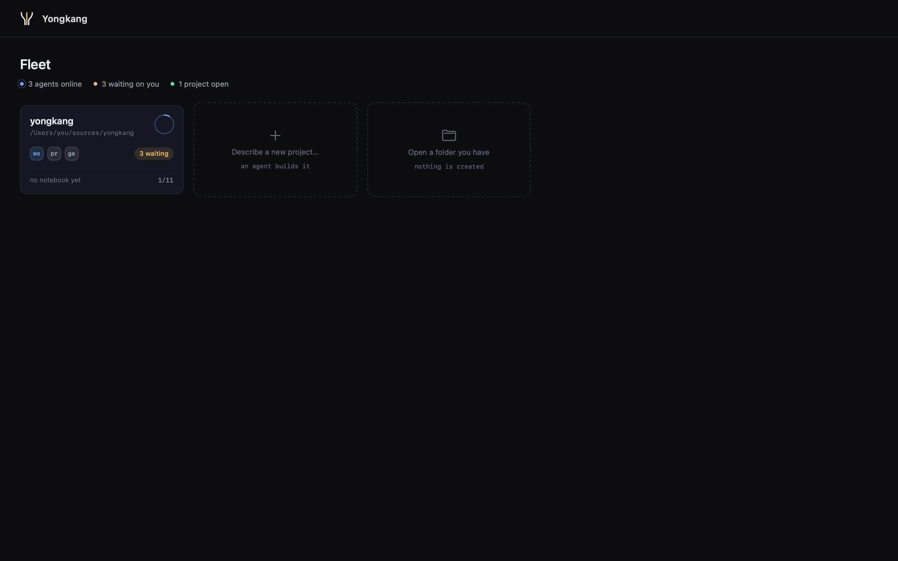

# Projects

Nothing starts until you pick a folder — that keeps macOS from prompting for iCloud
Drive / Music / Documents, which is what happened when it defaulted to `$HOME`.

A project is a folder. The app opens on the all-projects screen; click a card to enter one,
and `Go ▸ All Projects` (⌘[) to leave. Right-click a card to reveal its folder or remove it
from the screen; the folder stays on disk. Agents keep
running while you are away: terminals are hidden, never torn down.

Two tiles sit at the end of the grid, one per door, and the `File` menu opens either from
anywhere, including from inside another project. `Describe a new project…` (`File ▸ New
Project…`, ⌘N) opens a prompt: say what to build and tag anything it should read with `@`. Where the folder
goes is worked out from the prompt — `~/code/todo` in it is enough — and otherwise it is
named after the prompt and lands beside the projects you already have (`~/Projects` on a
first run). The line under the box says where before you press Return. The folder is
created and the prompt goes straight to the session that writes its notebook.
`Open a folder you have` (`File ▸ Open Folder…`, ⌘O) is the other door, for a folder that
already exists; an empty one asks what it is for on the way in.

Open projects come back on the next launch. Only the folders are remembered, not the
sessions — those PTYs died with the app — and a folder that has since moved is dropped
from the list rather than shown broken.

Inside a project, `Overview` is what it is doing right now: the agents running, what is
waiting on you, what changed on disk, and what the agents last wrote to the notebook.
Everything on it is read from the notebook, the transcripts and git — the app keeps no
state of its own to drift.

Inside a project, use the Agent switch in the window's toolbar to choose Claude Code, Codex,
Grok, or Agy. The choice is remembered and applies to new notebook setup, Product, Engineering
Lead, unblock, and plain sessions; sessions already running keep their original agent.
