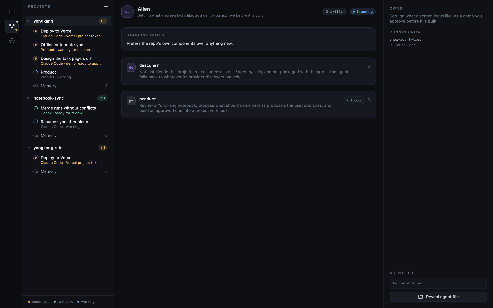

# The team

Ordinary work goes straight to the agent you assign it to; the team is for agents with a
skill of their own. They are files, not code: one Markdown file per agent in
`.notebook/team/`, each with `name`, the `skills` that are its system prompt, and the
`owns` line work is routed by. The one shipped agent, Allen, runs `designer` for design
tasks, and is written there the first time a project with a notebook is opened; after that
the folder is the truth, so editing a file — or deleting one — changes who gets dispatched.
A roster member's page shows the skill text the agent is actually handed plus its agents running
right now.

`New → Team Member…` adds one, two ways:

**Manual** is the form: a name, the skills to give it, and what it owns. The skill list is
every skill this project can already load — `.claude/skills/` and `.agents/skills/` in the
project, the same two folders in `$HOME`, and the ones packaged with the app — listed by
folder, which is the name an agent asks for. `From a git repo` shallow-clones a repo,
copies every folder in it holding a `SKILL.md` into the project's `.claude/skills/`, and
links each one into `.agents/skills/` so Claude Code and Codex read the same file; what it
installed is ticked for you. Pointing it at the same repo again updates those skills.

**Incubate** is a description instead of a form: say what the agent should do and a
session goes and builds it — reads the skills you already have, fetches a published one or
writes a new one when nothing fits, then writes the roster file. The app writes nothing
here, the same rule the notebook follows, and the new agent appears on the roster when
that session lands — it runs the packaged `incubate-agent` skill, which is what knows
where skills live and what a roster file has to say.
